

<a href="https://studio.dostlarkonagi.com">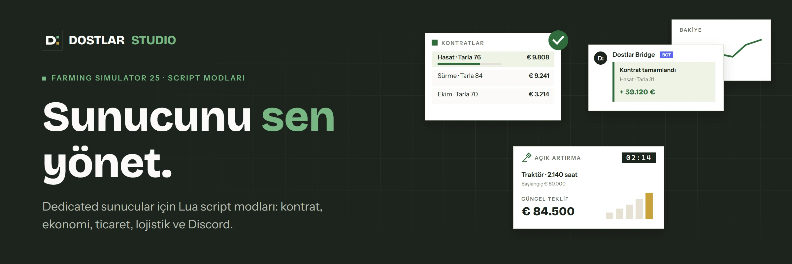</a>

Dostlar STUDIO, [dostlarkonagi.com](https://dostlarkonagi.com) topluluğunun mod atölyesi.
Kiralık dedicated sunucularda karşılaştığımız gerçek sorunlardan yola çıkıyoruz: kontrat ürününü
çalan oyuncu, anlamını yitiren sunucu ekonomisi, Discord'a taşınmayan sunucu verisi, fabrikanın
önünde yığılan paletler. Kontrat ve ekonomi modlarının yanında oyuncular arası pazar, ikinci el
mezatı ve palet lojistiği de yazıyoruz. Her mod önce kendi sunucumuzda çalışıyor, sonra yayına giriyor.

## Modlar

2 yayında, 6 geliştirmede. Hepsi çok oyunculu ve dedicated sunucu için yazıldı.

<table>
<tr>
<td width="50%" valign="top">

<a href="https://studio.dostlarkonagi.com/mods/contract-manager/">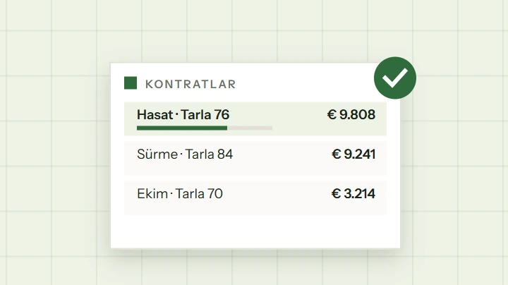</a>

### [Kontrat Yöneticisi](https://studio.dostlarkonagi.com/mods/contract-manager/)

`FS25_ContractManager` · Sunucu yönetimi

Kontrat üretimini, limitleri, ödül ve ceza modelini sunucu yöneticisinin eline verir. Kontrat ürününü hırsızlığa karşı korur, ortak kontrat ve devir açar.

 · [Kaynak kodu](https://github.com/Dostlar-Studio/FS25_ContractManager)

</td>
<td width="50%" valign="top">

<a href="https://studio.dostlarkonagi.com/mods/discord-bridge/">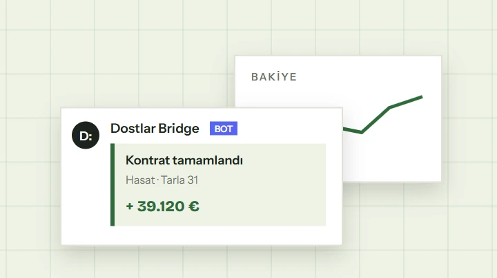</a>

### [Discord Bridge](https://studio.dostlarkonagi.com/mods/discord-bridge/)

`FS25_DiscordBridge` · Sunucu entegrasyonu

Sunucudaki bakiye, tarla, araç, fiyat, kontrat ve olay verisini Discord'a ve tarayıcıya taşır. Köprü bizim altyapımızda çalışır; sen yalnızca modu sunucuya atarsın.

 · [Köprü paneli](https://bridge.dostlarkonagi.com/)

</td>
</tr>
<tr>
<td width="50%" valign="top">

<a href="https://studio.dostlarkonagi.com/mods/farm-market/">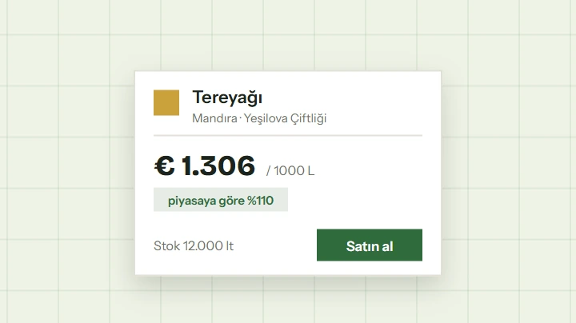</a>

### [Oyuncu Pazarı](https://studio.dostlarkonagi.com/mods/farm-market/)

`FS25_FarmMarket` · Ekonomi

Üretim çıktıları için oyuncular arası ticaret. Fabrika sahibi ürettiğini satışa açar, girdi için alış ilanı verir; başka çiftlikler gelip alır ya da getirip satar.

</td>
<td width="50%" valign="top">

<a href="https://studio.dostlarkonagi.com/mods/vehicle-auction/">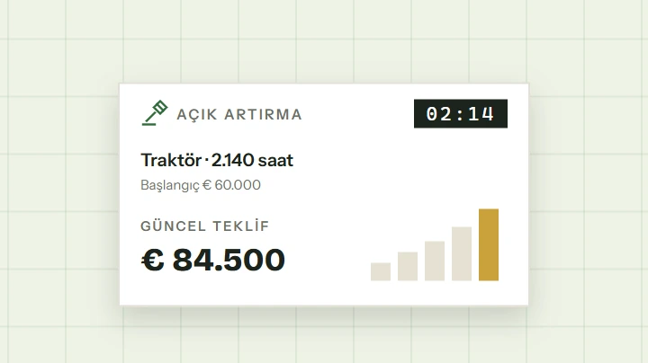</a>

### [Mezat](https://studio.dostlarkonagi.com/mods/vehicle-auction/)

`FS25_VehicleAuction` · Ekonomi

Sabit fiyatlı ikinci el pazarını saatli açık artırmayla değiştirir. Sınırlı sayıda araç belirli saatlerde gelir ve en yüksek teklifi verene satılır.

</td>
</tr>
<tr>
<td width="50%" valign="top">

<a href="https://studio.dostlarkonagi.com/mods/pallet-storage/">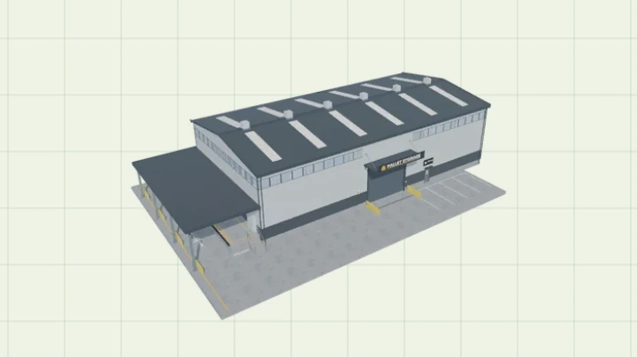</a>

### [Palet Deposu](https://studio.dostlarkonagi.com/mods/pallet-storage/)

`FS25_DSPalletStorage` · Lojistik

Oyunun kendi nesne deposu sistemi üzerine kurulu, üç boyda kapalı palet deposu. Paletler dokta girer, içerideki raflarda görünür, fabrikaya ya da pazara buradan gider.

</td>
<td width="50%" valign="top">

<a href="https://studio.dostlarkonagi.com/mods/trade-center/">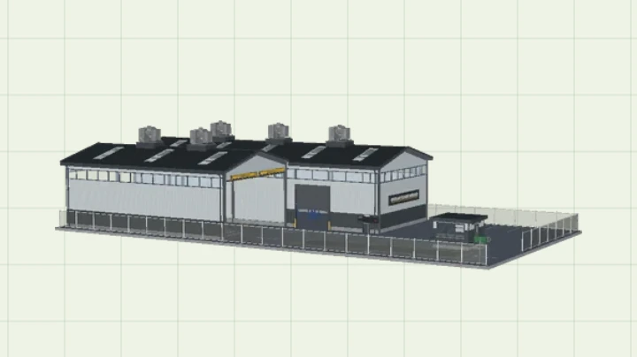</a>

### [Dostlar Ticaret Merkezi](https://studio.dostlarkonagi.com/mods/trade-center/)

`FS25_DSTradeCenter` · Ekonomi

Haritaya yerleştirilen, kantarlı ve herkese açık bir satış noktası. Fiyatlar piyasayı izler ve ürün ürün dalgalanır, her satışa numaralı fatura kesilir; sunucu yöneticisi fiyatları tek tablodan ayarlar.

</td>
</tr>
<tr>
<td width="50%" valign="top">

<a href="https://studio.dostlarkonagi.com/mods/pallet-cargo-semi/">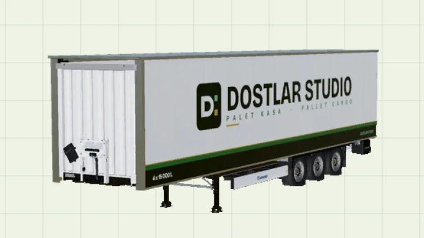</a>

### [Palet Kasa Dorse](https://studio.dostlarkonagi.com/mods/pallet-cargo-semi/)

`FS25_PalletCargoSemi` · Lojistik

Tırlar için kapalı kasa dorse; paletli ürünleri litre olarak taşır. Oyunun orijinal Krone Profi Liner şasisi üzerinde sert bir Dostlar STUDIO kasa.

</td>
<td width="50%" valign="top">

<a href="https://studio.dostlarkonagi.com/mods/pallet-cargo-trailer/">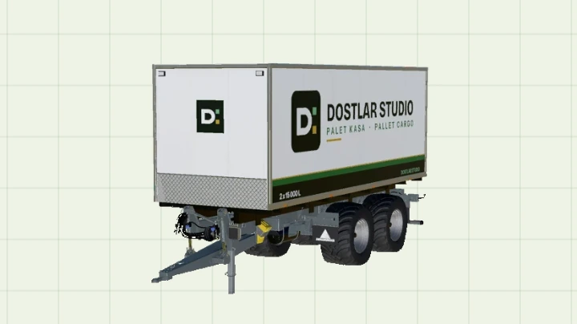</a>

### [Palet Kasa Römork](https://studio.dostlarkonagi.com/mods/pallet-cargo-trailer/)

`FS25_PalletCargoTrailer` · Lojistik

Traktörler için kapalı kasa römork; paletli ürünleri litre olarak taşır. Oyunun orijinal Annaburger HTS 22B.79 şasisi üzerinde sıfırdan çizilmiş bir Dostlar STUDIO kasa.

</td>
</tr>
</table>

Her modun ayrıntılı sayfası, özellik listesi ve indirme bağlantısı
[studio.dostlarkonagi.com](https://studio.dostlarkonagi.com) üzerinde. Rafa kaldırılan modlar sitenin
[Arşiv](https://studio.dostlarkonagi.com/arsiv/) sayfasında.

Kullanım şartları, lisans, yasal uyarı ve gizlilik: [studio.dostlarkonagi.com/yasal](https://studio.dostlarkonagi.com/yasal/).
Kısacası modları kullanabilir, düzenleyebilir ve bir mod paketine koyabilirsin; tek şart Dostlar STUDIO
adını belirtmek. Zip'i başka bir siteye yeniden yüklemek ve modları satmak yasak.

## Stüdyodan

<table>
<tr>
<td width="50%" valign="top">

<a href="https://farmtowny.com/">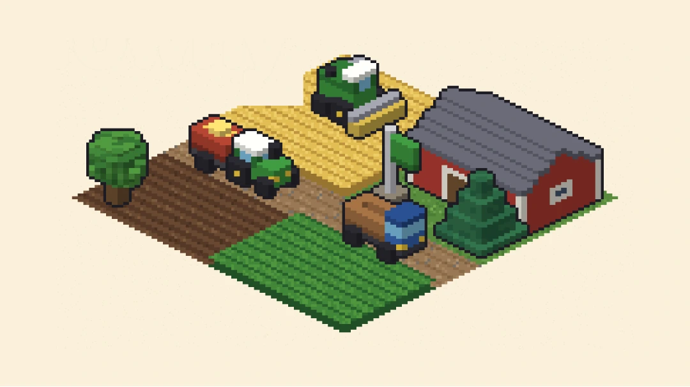</a>

### [Farm Towny](https://farmtowny.com/)

Herkesin aynı köyde çiftlik kurduğu izometrik bir tarım oyunu. Tarlanı sür, ek, biç; ürününü kamyonla pazara taşı. Köy gece gündüz akar, sen yokken de tarlaların büyür. Tarayıcıda oynanır, bir şey indirmen gerekmez.

Oyun geliştirme aşamasında ve çoğu zaman kapalı; testler ara sıra açılıyor. Test açıkken farmtowny.com'dan girebilirsin.

</td>
<td width="50%" valign="top">

<a href="https://community.dostlarkonagi.com/">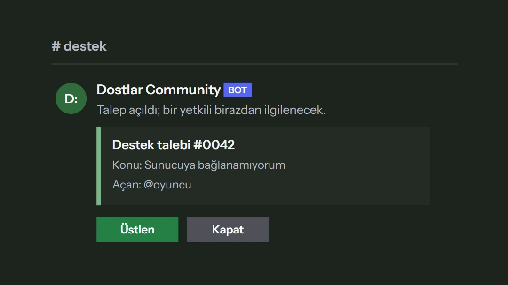</a>

### [Dostlar Community](https://community.dostlarkonagi.com/)

Discord toplulukları için destek talebi, seviye ve moderasyon botu; karşılama, başvuru, çekiliş ve kayıt kanalları da var. Hangi özelliklerin açık olacağına sen karar verirsin, her şeyi web panelinden ayarlarsın. Türkçe, İngilizce ve Almanca konuşur.

Eklediğin sunucu bot sahibinin onayını bekler; o sürede bot sunucunda hiçbir şey yapmaz ve veri tutmaz.

</td>
</tr>
</table>

## Nasıl yazıyoruz

- **Oyunun kendi ekranları.** Ayrı bir HUD kurmuyoruz. Kurallar ESC menüsündeki ayarlar sekmesinde,
  işlemler oyunun kendi sayfalarında. Tuş ataması çoğu modda gerekmiyor.
- **Sunucu yetkili.** Kural ve koruma kararları sunucu tarafında veriliyor. Modifiye istemci de
  kuralı deleyemiyor.
- **Çok oyunculu önce gelir.** Modlar dedicated sunucuda test ediliyor; ayarlar kayıt dosyası başına
  saklanıyor ve tüm oyuncularda senkron kalıyor.
- **Üç dil, tek paket.** Türkçe, İngilizce ve Almanca metinler her modun içinde geliyor;
  Kontrat Yöneticisi'nde ayrıca Fransızca var.
- **Ölçülü maliyet.** Her karede iş yapan kanca yazmıyoruz; diske yazma ve olay kancaları
  sunucuyu kasmayacak sıklıkta çalışıyor.

## Kurulum

Mod zip'ini sunucunun ve bağlanan tüm oyuncuların `mods` klasörüne koy, kayıt için modu etkinleştir
ve sunucuyu yeniden başlat. Herkeste aynı sürüm olmalı. Script modu oldukları için yalnızca PC ve Mac.

Ayar dosyaları `Documents/My Games/FarmingSimulator2025/modSettings/` altında ilk çalıştırmada
varsayılanlarla oluşuyor; içindeki her şey oyun içinden de değiştirilebiliyor.

## Destek ve sorun bildirimi

- Depoların **Issues** sekmesi (örn. [FS25_ContractManager](https://github.com/Dostlar-Studio/FS25_ContractManager/issues))
- Discord: [Dostlar STUDIO](https://discord.gg/rGvQUCk5FK) sunucusundaki destek forumu (İngilizce)
- E-posta: <hello@kahrastudio.art>

Hata bildirirken `log.txt` dosyasının ilgili satırlarını eklersen çok daha hızlı çözülüyor.

---

<b>English</b>

**Dostlar STUDIO** is the mod workshop of the [dostlarkonagi.com](https://dostlarkonagi.com) community.
Everything below is also on our site in English: [studio.dostlarkonagi.com/en](https://studio.dostlarkonagi.com/en/).
We write Lua script mods for Farming Simulator 25, aimed at rented dedicated servers: contract abuse,
server economy, Discord integration, player-to-player trade, used vehicle auctions and pallet
logistics. Every mod runs on our own server before release.

| Mod | What it does | Version | Status |
| --- | --- | --- | --- |
| [FS25_ContractManager](https://github.com/Dostlar-Studio/FS25_ContractManager) | Puts contract generation, limits and the reward/penalty model in the server admin's hands. Guards the contract product against theft and opens up shared contracts. | 1.26.0.0 | Released |
| [FS25_DiscordBridge](https://bridge.dostlarkonagi.com/) | Carries balance, field, vehicle, price, contract and event data from the server to Discord and to your browser. The bridge runs on our infrastructure; all you do is drop the mod onto your server. | 1.6.1.0 | Released |
| [FS25_FarmMarket](https://studio.dostlarkonagi.com/en/mods/farm-market/) | Player-to-player trade around production. A factory owner lists outputs for sale and posts buy offers for inputs; other farms come to buy, or bring goods and sell. | 1.9.0.0 | Early development |
| [FS25_VehicleAuction](https://studio.dostlarkonagi.com/en/mods/vehicle-auction/) | Replaces the fixed-price used vehicle market with timed auctions. A limited number of vehicles arrives in scheduled windows and goes to the highest bidder. | 0.19.1.0 | Early development |
| [FS25_DSPalletStorage](https://studio.dostlarkonagi.com/en/mods/pallet-storage/) | A closed pallet storage in three sizes, built on the game's own object storage system. Pallets enter at the dock, show up on the racks inside, and go on to factories or the market from here. | 1.15.0.0 | Early development |
| [FS25_DSTradeCenter](https://studio.dostlarkonagi.com/en/mods/trade-center/) | A placeable public selling point with a weighbridge. Prices follow the market and drift per product, every sale gets a numbered invoice, and the server admin sets prices from a single table. | 1.18.6.0 | Early development |
| [FS25_PalletCargoSemi](https://studio.dostlarkonagi.com/en/mods/pallet-cargo-semi/) | A closed-body semi-trailer for trucks that carries pallet goods as litres. A rigid Dostlar STUDIO body on the game's original Krone Profi Liner chassis. | 1.17.0.0 | Early development |
| [FS25_PalletCargoTrailer](https://studio.dostlarkonagi.com/en/mods/pallet-cargo-trailer/) | A closed-body trailer for tractors that carries pallet goods as litres. A Dostlar STUDIO body drawn from scratch on the game's original Annaburger HTS 22B.79 chassis. | 1.17.0.0 | Early development |

Mod pages and downloads: [studio.dostlarkonagi.com/en](https://studio.dostlarkonagi.com/en/).
Shelved mods are on the site's [Archive](https://studio.dostlarkonagi.com/en/archive/) page.
Terms of use, license, legal notice and privacy: [studio.dostlarkonagi.com/en/legal](https://studio.dostlarkonagi.com/en/legal/).
In short: you may use the mods, edit them and include them in a modpack as long as you credit
Dostlar STUDIO. Reuploading the zip elsewhere and selling the mods are not allowed.
Design notes: no custom HUD, the game's own screens only; rules are server authoritative;
multiplayer and dedicated first; Turkish, English and German (plus French in Contract Manager).

Beyond mods:

- **[Farm Towny](https://farmtowny.com/)** (game, in development): An isometric farming game where everyone builds a farm in the same village. Plough, sow and harvest your fields, then truck your produce to market. The village runs day and night, so your crops keep growing while you are away. It plays in the browser, nothing to download.
- **[Dostlar Community](https://community.dostlarkonagi.com/)** (discord bot, released): A support ticket, level and moderation bot for Discord communities, with welcome messages, applications, giveaways and log channels too. You decide which features are on and set everything up in the web dashboard. It speaks Turkish, English and German.

Put the mod zip into the `mods` folder of the server and of every player, enable it for the savegame
and restart. All players need the same version. PC/Mac only, script mods.

Bug reports: the Issues tab of the repository, the support forum on our [Discord](https://discord.gg/rGvQUCk5FK),
or <hello@kahrastudio.art>. Please attach the relevant lines of `log.txt`.

